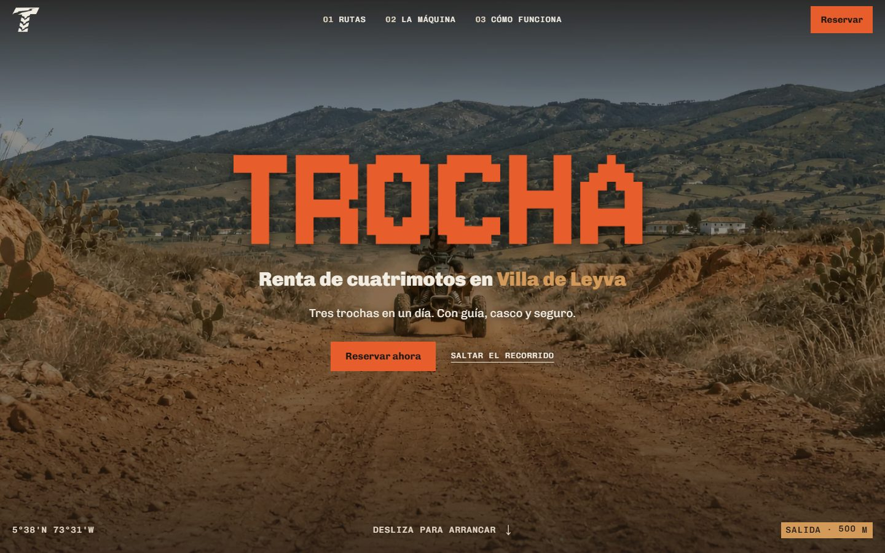
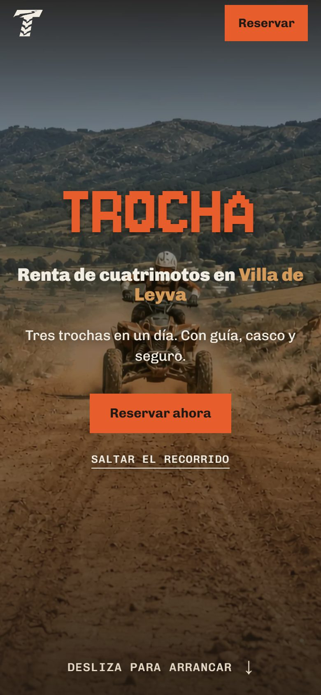
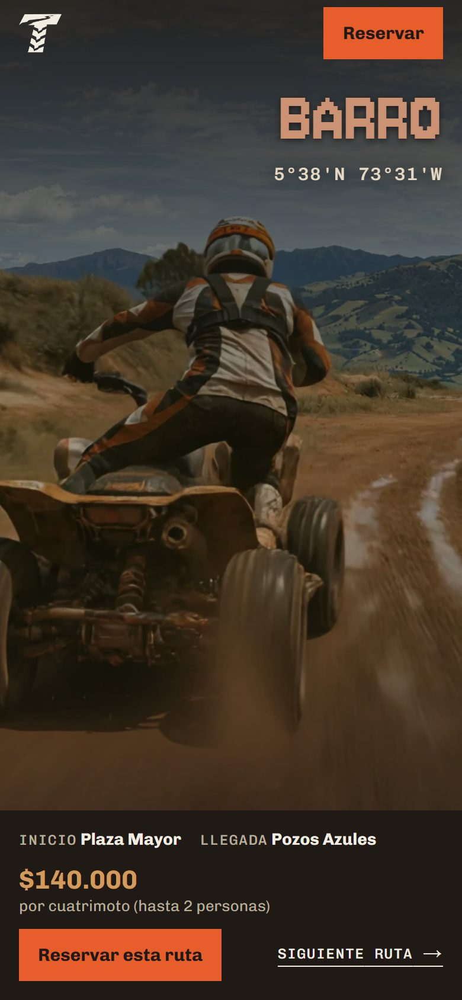
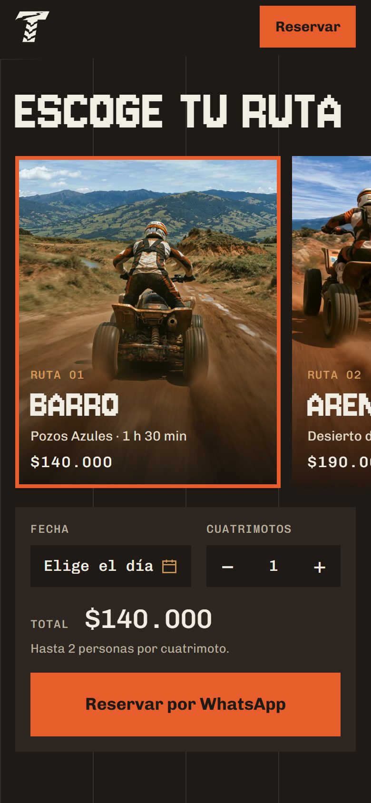
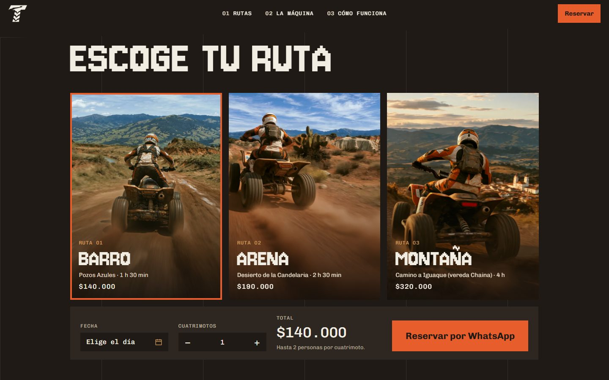
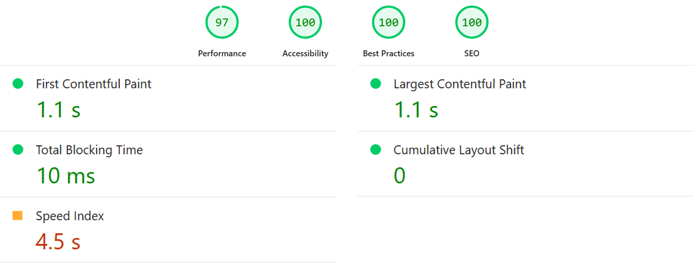
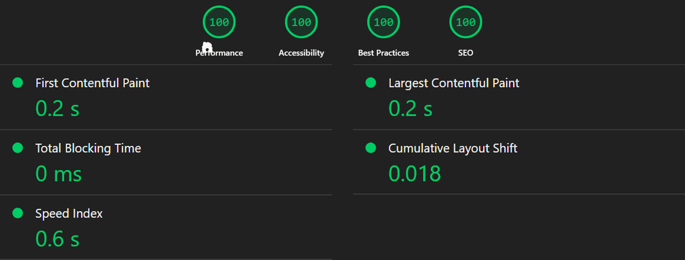

<div align="center">

# TROCHA · A landing page for a quad bike rental

**Scroll and you're riding.**
A concept site for a fictional quad bike rental in Villa de Leyva, Colombia: the page is a first-person ride through three dirt routes, with a booking ticket for each one and a one-tap WhatsApp reservation.

[**Visit the demo →**](https://jesusgabri3l.github.io/trocha/)

<br />



</div>

## Overview

A landing page concept for a fictional brand. TROCHA is not a real business: the name, routes, prices and WhatsApp number are made up. The places are real.

<table>
  <tr>
    <td align="center" width="33%"><br /><sub>Hero</sub></td>
    <td align="center" width="33%"><br /><sub>Route</sub></td>
    <td align="center" width="33%"><br /><sub>Booking</sub></td>
  </tr>
</table>

- **Hero:** the rider takes off as you scroll, then the hero lifts like a shutter and the ride begins.
- **The ride:** three routes (Barro, Arena, Montaña) joined by short transitions. Each route shows its name in the color of its terrain, coordinates, a milestone counting kilometers and a ticket with distance, duration and price.
- **The machine:** the quad bike and what's included (guide, helmet, insurance).
- **Booking:** one card per route (a swipeable carousel on phones), a custom date picker and how many quads; the total updates and the WhatsApp button carries the full message.



## How it's built

**Astro 7** (static) · **GSAP** ScrollTrigger · Lenis · Sass · TypeScript · GitHub Pages.

- **One continuous video, cut into frames.** Each route and transition is an AI clip (Kling 4.0) that starts from the real last frame of the previous one, so the landscape and the rider's outfit stay consistent. The whole ride went through Topaz in a single pass, so there are no jumps between clips. 528 frames ship as AVIF (1920 px on desktop, a 608 px vertical crop on phones; 34 MB and 14 MB in total, about a third of the WebP version) and are drawn on a `<canvas>` as you scroll.
- **Frames load where you are.** The whole ride starts downloading in the background while you watch the hero, but the queue always picks the frame closest to your scroll position first (every fourth frame counts as closer, so a fast scroll still gets a moving picture). Only the frames around the current one are decoded (off the main thread with `createImageBitmap`, three at a time), so memory stays low on phones.
- **The first frame is plain HTML.** The hero's first frame is an `` with high fetch priority, so it paints before any JavaScript runs; the canvas takes over on top of it.
- **Transitions hide the cuts.** A jump over a crest and a dark tunnel connect the routes; the page color switches to the next terrain at the darkest frame.
- **Accessible.** Readable contrast on video, visible focus states, and with *reduce motion* the page shows still frames without scroll animations.

## PageSpeed

PageSpeed Insights on the [live demo](https://jesusgabri3l.github.io/trocha/), November 18, 2026:

<table>
  <tr>
    <th width="50%">Mobile</th>
    <th width="50%">Desktop</th>
  </tr>
  <tr>
    <td></td>
    <td></td>
  </tr>
</table>

| PageSpeed | Mobile | Desktop |
|---|---|---|
| First Contentful Paint | 1.1 s | 0.2 s |
| Largest Contentful Paint | 1.1 s | 0.2 s |
| Cumulative Layout Shift | 0 | 0.018 |
| Total Blocking Time | 10 ms | 0 ms |

## Development

Requires Node 22 or later.

```sh
npm install
npm run dev       # local server at http://localhost:4321
npm run build     # builds the site into ./dist/
npm run preview   # serves the build locally
```

`scripts/` holds one-off helpers for the asset pipeline; the source videos stay out of the repo.

## Author

Jesús Ahumada — [Portfolio](https://jesusgabriel.dev/) · [LinkedIn](https://www.linkedin.com/in/jesus-ahumada) · [GitHub](https://github.com/jesusgabri3l)
